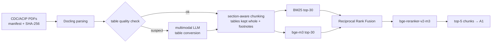

# VaxRAG: where and why RAG fails on vaccine guidelines

> **🚧 Project status: early stage, not yet run.**
> The study design and the full evaluation pipeline are implemented and covered by an automated
> test suite, but **no experiments have been run and there are no results yet**. The knowledge
> base is being assembled and expert annotation has not started. The design may still change
> before pre-registration.

VaxRAG is a pre-specified study evaluating whether large language models (LLMs) answer vaccine questions more accurately when given the official CDC/ACIP immunization guidelines through retrieval-augmented generation (RAG). Using the English VaxEval benchmark, it compares closed-book answering, standard RAG, LLM-selected full guidelines, and an oracle condition across frontier and open-weight models. Beyond overall accuracy, it examines where RAG helps and where it fails, including retrieval coverage, table-based content, and whether cited evidence actually supports the answer. The goal is to give public health agencies evidence on the optimal development strategy for vaccine information agents: which models to use, how to supply guideline knowledge, and where human oversight is still needed.

**At a glance**

- **Question bank:** ~1,340 English multiple-choice questions from the VaxEval benchmark [1].
- **Knowledge base:** all current CDC/ACIP recommendations, frozen and hashed.
- **Four arms:** closed book (A0), standard hybrid RAG (A1), oracle evidence (A2), and model-selected
  full PDFs (A3).
- **Five models:** Claude Opus 4.6, GPT-5.2 and Gemini 3.1 Pro (APIs), plus Gemma 3 27B and
  MedGemma 27B (self-hosted). The Gemma/MedGemma pair isolates the effect of medical fine-tuning.
- **Contamination controlled by design:** every model's training-data cutoff precedes the
  question bank's public release.
- **Expert annotation:** two infectious-disease physicians (adult and pediatric) annotate every
  question independently.
- **Evaluation:** accuracy, retrieval, error attribution, and citation faithfulness and
  correctness. LLM judges are validated against the physicians.

---

## Contents

1. [Background](#background)
2. [Research questions and hypotheses](#research-questions-and-hypotheses)
3. [Data](#data)
4. [Study design](#study-design)
5. [RAG pipeline](#rag-pipeline)
6. [Evaluation](#evaluation)
7. [Statistical analysis](#statistical-analysis)
8. [Engineering for reproducibility](#engineering-for-reproducibility)
9. [Limitations](#limitations)
10. [Next steps](#next-steps)
11. [Repository layout and usage](#repository-layout-and-usage)
12. [Roadmap](#roadmap)
13. [References](#references)
14. [Copyright](#copyright)

---

## Background

When LLMs get vaccine questions wrong, they mostly get the **rules** wrong: dose intervals,
contraindications and age eligibility. These rules are written down in CDC/ACIP guidelines, so
RAG should in principle fix them. This has not been rigorously tested.

- **VaxEval** ([Chen et al., *npj Vaccines*, 2026](https://doi.org/10.1038/s41541-026-01500-1))
  evaluated 13 LLMs on 1,886 vaccine questions
  (mean English accuracy 86%). Almost half of 150 sampled errors came from over-generalisation.
  RAG was not tested.
- **Vaccine RAG systems** reported so far are mostly prototypes or single systems. AI-VaxGuide
  (arXiv, 2025) was not compared with frontier models without retrieval. COVID-19 fact-checking
  work (Li et al., *JMIR*, 2025) targets general claims rather than vaccination rules.
- **Medical RAG methodology.** MedRAG/MIRAGE (Xiong et al., 2024) found gains of up to 18% from
  RAG, but also "lost-in-the-middle" effects. RAG-X (2026) found a 14-point gap between "answered
  correctly" and "answered correctly with valid grounding".

**Gap.** No study has decomposed RAG performance on vaccine guidelines into retrieval, generation
and citation, against an oracle upper bound and on the same question bank. Such guidelines
include complex, multi-page schedule tables.

## Research questions and hypotheses

**Primary objective:** does giving LLMs CDC/ACIP guideline text improve accuracy on vaccine
multiple-choice questions, and where are gains made or lost?

| | Hypothesis |
| --- | --- |
| **H1 (primary)** | Standard RAG (A1) is more accurate than closed-book answering (A0), pooled over the five models. |
| H2 | The RAG benefit differs by model; smaller models (Gemma, MedGemma) benefit more (arm × model interaction). |
| H3 | Oracle evidence (A2) is more accurate than standard RAG; the gap measures *retrieval loss*. |
| H4 | With RAG, questions answered by a **table** are answered less accurately than questions answered by running **text**. |
| H5 | MedGemma beats Gemma closed-book, but the gap narrows with RAG. |

**Exploratory questions**

- **Citations.** Do the cited passages actually support the answer? How often is a correct answer
  given with a citation that does not support it?
- **Full documents instead of RAG (A3).** Is it more accurate to let the model choose whole
  guideline PDFs and read them than to use standard RAG? How many A3 errors come from choosing the
  wrong document, and how many from misreading the right one? A3 is a pilot for the next phase
  (open-ended clinical scenarios, see [Next steps](#next-steps)), where answers often need several
  passages from several documents and top-k retrieval may not be enough.

## Data

### Question bank

The questions are the English multiple-choice items of the **VaxEval** benchmark [1]: the
*Vaccine MCQs Dataset* on Zenodo ([10.5281/zenodo.18637915](https://zenodo.org/records/18637915),
v1, published **2026-02-14**, CC BY 4.0). This study uses `[final]English_MCQ_S1_labeled.xlsx` and
`[final]English_MCQ_S2_labeled.xlsx`. The files are not copied into this repository; download them
from Zenodo into `MCQ_dataset/`.

| Subset | Items | Format | Scoring |
| --- | --- | --- | --- |
| S1 | 918 | 4 options, one correct answer | correct option selected |
| S2 | 421 | 2-7 options, 68 items with several correct answers; includes survey-style items | exact set match ("select all that apply") |

There are 1,341 raw rows. One blank row and one item whose answer key points to an empty option
are excluded, which leaves 1,339 questions. The loader logs every exclusion with a reason.

### Knowledge base

The knowledge base contains every recommendation the ACIP lists as current on a fixed freeze
date, not only those for vaccines in the question bank, because a deployed system does not know
what users will ask. It also contains the ACIP General Best Practice Guidelines and the child,
adolescent and adult immunization schedules.

- **Several current documents for one vaccine:** all are included, because newer recommendations
  often amend only part of older ones.
- **Superseded documents:** excluded. The CDC Pink Book is not used.
- **Provenance:** a `manifest.csv` records publisher, title, version date, download date, URL and
  SHA-256 hash for every document. The pipeline refuses to run if a file changes after freezing.
- **Publication year in every chunk label:** e.g. `Cholera Vaccine ... (2021) › Recommendations`,
  so models can tell newer guidance from older.

### Expert annotation

Two infectious-disease physicians, one adult and one pediatric, annotate **all** questions
independently. Agreement is reported as Cohen's kappa per label, and gold-document overlap as the
share of questions with a shared document and the Jaccard index. Disagreements are settled by
consensus, and only the consensus labels enter the analysis.

| Label | Values | Used for |
| --- | --- | --- |
| `kb_covered` | yes / no | primary analysis population |
| `version_status` | current / outdated / unmappable (against the frozen guidelines) | primary analysis population; ACIP changed several recommendations in 2025-2026 |
| `answer_source` | table / text / both | H4 |
| `question_type` | fact / rule application / multi-condition reasoning | stratified accuracy |
| Gold passages | document, section, page, verbatim quote | oracle arm (A2), strict metrics |

**Gold passages are "one sufficient set of evidence", not an exhaustive list.** A question can
often be answered from several chunks or guidelines, and listing all of them is infeasible.
Evidence metrics are therefore reported in strict, lenient and judged versions (see
[Evaluation](#evaluation)).

**Primary analysis population:** questions with `kb_covered = yes` and `version_status = current`.
All questions are analysed as a secondary population.

## Study design

### Arms

| Arm | Context given to the model | What it measures |
| --- | --- | --- |
| A0 | none (closed book) | what the model knows on its own |
| A1 | top-5 chunks from hybrid retrieval | RAG as deployed (**primary**) |
| A2 | annotated gold passages (oracle) | upper bound with perfect retrieval |
| A3 | up to 3 whole PDFs that the model selects from the document catalog; no retrieval | reading full documents instead of RAG (exploratory) |

How to read the arm differences:

- **A1 − A0:** the benefit of RAG.
- **A2 − A1:** retrieval loss. Part of this gap is distraction by irrelevant chunks, because A2
  contexts are shorter.
- **A2 − A0:** the maximum benefit the guidelines can provide.
- **A3 − A1:** full documents versus retrieval.

**A3 runs in two steps.** First, the model sees the question and the document catalog (ID, title
with year, type) and selects the fewest documents it needs, at most three. Then it answers with
those PDFs attached natively.

- A3 runs only for the three API models: MedGemma is text-only and vLLM does not accept PDFs.
- The primary regressions (H1/H2) therefore use A0-A2, and A3 is analysed separately against A1
  and A0.

### Models and contamination control

Instead of testing for contamination after the fact, the study **only evaluates models whose
training-data cutoff precedes the question bank's release (2026-02-14)**. The code refuses to run
any model whose cutoff is missing or too late.

| Role | Model (pinned ID) | Released | Training-data cutoff |
| --- | --- | --- | --- |
| Frontier 1 | Claude Opus 4.6 (`claude-opus-4-6`) | 2026-02-05 | 2025-08 |
| Frontier 2 | GPT-5.2 (`gpt-5.2-2025-12-11`) | 2025-12-11 | 2025-08-31 |
| Frontier 3 | Gemini 3.1 Pro (`gemini-3.1-pro-preview`) | 2026-02-19 | 2025-01 (to be confirmed) |
| Open, base | Gemma 3 27B-it (vLLM, bf16) | 2025-03 | 2024-08 |
| Open, medical | MedGemma 27B text-it (vLLM, bf16) | 2025-05 | ≤ 2025-05 |

- **Gemma and MedGemma** share an architecture and differ only in medical fine-tuning, which
  isolates its effect (H5).
- **Gemini 3.1 Pro** was released after the bank but trained on earlier data.
- **Excluded models:** Gemini 3 Pro (shut down) and newer models such as Claude Opus 4.7+ and
  Gemma 4.

**Settings.**

- **Temperature:** 0 where the API accepts it; otherwise the provider default, which is recorded.
- **Reasoning:** the lowest level for every model: off for Claude Opus 4.6, `none` for GPT-5.2,
  `low` for Gemini 3.1 Pro.
- **Prompt:** one shared zero-shot template.
- **Output:** structured JSON enforced by each provider's schema mode, or guided decoding on vLLM.
- **Refusals:** provider-side refusal fallbacks are deliberately disabled, because they would
  silently switch to another model. Refusals are logged and scored as incorrect.

## RAG pipeline



- **Chunking.** Chunks follow section headings, about 400-800 tokens with 10% overlap. Each one
  starts with `Title (year) › Section path`.
- **Tables are the main technical risk** in schedule documents: multi-page tables, merged cells,
  colour coding and dense footnotes.
  - A table is never cut mid-row. Long tables are split into row groups that repeat the header.
  - Footnotes and notes stay with their table.
  - Each table is stored twice: as plain-language row descriptions, which are indexed for
    retrieval, and as a Markdown table, which is what the model sees.
  - Tables that fail an automatic quality check are re-converted from page images by a multimodal
    model.
- **Targeted table review.** Tables are not all checked by hand. Only tables retrieved for a wrong
  A1 answer are queued for manual review, ordered by suspicion: cited by the wrong answer,
  relevant to the question, number of models that failed.
  - Faulty tables found in the pilot are fixed before the knowledge base is frozen.
  - In the main experiment, reviews only attribute errors: faulty table versus correct table
    misread.
- **Retrieval is computed once and frozen.** Results are cached under a hash of the retrieval
  settings and of the chunk set, so every model and every machine sees the same chunks.
- **Sensitivity analyses:** top-k 3/10, dense-only retrieval, no reranker, stem-only queries,
  MedCPT embeddings, Docling-only tables.

## Evaluation

The primary outcome is **accuracy**. Everything else explains where accuracy changes.

**Strict, lenient and judged evidence.** Because gold passages are not exhaustive, every evidence
metric is reported three ways:

| Version | Evidence = | Property |
| --- | --- | --- |
| strict | annotated gold chunks only | lower bound, no LLM needed |
| lenient | gold + chunks an LLM judge rated as supporting the correct answer (TREC-style pooling over top-10 results and all cited chunks) | reported for k ≤ 10 |
| judged | an LLM judge's verdict that the retrieved context is *sufficient* to answer correctly | primary for error attribution |

| Layer | Metrics |
| --- | --- |
| Answers | accuracy (stratified by subset, vaccine, question type, answer source); rescue/harm flips A0 → A1 |
| Retrieval | Recall@k, MRR, document hit rate (strict and lenient); context sufficiency |
| Error attribution (A1) | 2 × 2 quadrants: evidence present/absent × correct/incorrect → grounded success, generation failure, own knowledge, retrieval failure |
| Citation validity | is each quote verbatim (fuzzy) in the passage or document it cites? |
| Citation correctness | strict: is a gold chunk cited? judged: do the cited chunks support the *correct* answer? |
| Grounding | do the quotes support the answer the model *selected*? (faithfulness; the judge does not see the key) |
| Fabricated citations (A0) | do guideline titles and sections cited from memory exist in the knowledge base? |
| Document selection (A3) | was the gold document selected; number of documents; accuracy when it was and was not selected |
| Tables | share of wrong A1 answers whose context contained a table confirmed as mis-parsed |
| Efficiency | tokens, cache hits, latency, cost per correct answer, parse-failure and refusal rates |

**LLM judges.** One judge model, which is not among the evaluated models, makes three kinds of
judgment: grounding, chunk relevance and context sufficiency. Each kind is validated against the
two physicians on a blinded sample, reported as Cohen's kappa. Undeterminable judged metrics stay
missing rather than being counted as wrong, and their coverage is reported. A sample of wrong
answers is also categorised by hand (dose interval, contraindication, age eligibility, table
misread, outdated document).

## Statistical analysis

- **Primary model (H1, H2).** GEE logistic regression with questions as clusters, exchangeable
  working correlation and robust standard errors.
  - H1: the population-averaged odds ratio for A1 versus A0, pooled over models.
  - H2: a robust Wald test of the arm × model interaction.
- **GLMM sensitivity analysis.** Bayesian mixed logistic regression with a random intercept per
  question.
- **Per-model comparisons.** Exact McNemar tests (A1 vs A0, A2 vs A1, A2 vs A0; for the API
  models also A3 vs A1 and A3 vs A0) with Holm correction, and question-level bootstrap 95% CIs.
- **H5:** paired MedGemma − Gemma differences within each arm.
- **Consistency:** 300 questions are repeated three times in arms A0-A2.
- **Power:** assuming 15% discordant pairs, 1,339 questions give about 95% power to detect a
  4-point difference per model (α = 0.05), and about 85% after Holm correction.
- **Pre-registration:** hypotheses, the primary contrast and population, RAG settings and judge
  decision rules are registered on OSF before the main run.

## Engineering for reproducibility

- **Every LLM call is logged** as one JSONL line: full prompt, context IDs, raw response, parsed
  answer, provider model version, tokens (including cache reads and writes), latency, cost, git
  commit and timestamp.
- **Resumable and append-only.** Each call has a deterministic ID (question, model, arm,
  repetition, prompt version).
  - Re-running a run skips finished calls, so interruptions never cause double billing.
  - Parse failures are retried once and then scored as incorrect; API errors are retried on the
    next invocation.
  - A3 document selections are stored and reused, so a retry never silently changes the evidence.
- **Frozen settings.** Each run stores its merged config, a hash of every result-affecting
  setting, and `pip freeze`. Continuing a run with changed settings is refused. Execution-only
  settings (models, workers, endpoints) may differ, so API models and GPU-hosted models can run on
  different machines.
- **Versioned prompts.** Prompts are files (`prompts/<version>.*`); any wording change needs a new
  version.
- **Cost control.** In A3, PDFs are attached in a fixed order and marked for prompt caching, and
  costs are computed with cache-read and cache-write prices.
- **Environments.** `environment.yml` (macOS or Linux) for the pipeline; a separate
  `environment-vllm.yml` serves the open models on an NVIDIA GPU, so vLLM's pinned dependencies
  never conflict with the pipeline.
- **Tests.** A pytest suite runs with fake LLM clients; no network or GPU is needed. Lint and
  format: ruff.

## Limitations

- English only, US guidelines only, multiple-choice only; multiple choice cannot capture the risks
  of open-ended clinical advice.
- The models are 2025 to early-2026 versions chosen to avoid contamination, so they do not
  represent the newest models.
- Training-data cutoffs are vendor-reported. Zenodo lists no version of the question bank before
  2026-02-14; earlier circulation (e.g. preprints or conference abstracts) has not been ruled out
  entirely.
- S2 contains survey-style items (levels of agreement) whose answer keys depend more on the item
  authors' judgment.
- Gold passages are not exhaustive. Strict metrics are lower bounds, and lenient and judged
  metrics depend on LLM judges, which are validated on a sample only.
- The table review is targeted. Parsing errors in tables that were never retrieved for a wrong
  answer go undetected.
- In A3, providers convert PDFs differently, so model differences in A3 partly reflect PDF
  handling. A3 is not run for the open models.
- The judge model comes from the same vendor as one evaluated model (Claude), which may favour
  that model's answers.

## Next steps

1. **Open-ended clinical scenarios.** Infectious-disease physicians will write free-text clinical
   scenarios that require combining several passages and documents, and grade the answers. A3 in
   this study tests whether full-document reading or RAG should be used there.
2. **External validation with CDC CDSi test cases,** which provide reference answers for catch-up
   schedule calculations.
3. **Other jurisdictions:** Canada's NACI and Taiwan's ACIP guidelines, to test for
   cross-jurisdiction mix-ups.
4. **Cross-lingual evaluation:** VaxEval also provides Chinese and Spanish versions of S1, so
   the effect of English guidelines on non-English questions can be tested directly.
5. **A reusable vaccine-RAG benchmark:** release chunks, gold mappings and judged relevance
   (subject to the question bank's licence).

## Repository layout and usage

```
configs/        experiment settings (default.yaml, pilot.yaml, sensitivity/*.yaml)
prompts/        versioned prompt templates (answer, document selection, judges, table vision)
src/vaxrag/
  data/         question bank loader, annotations, inter-annotator agreement, manifest
  kb/           Docling parsing, table handling, chunking, multimodal table conversion
  retrieval/    BM25, dense (bge-m3 / MedCPT), RRF, reranker, retrieval metrics
  llm/          provider clients (Anthropic, OpenAI, Gemini, vLLM), PDF input, prompt caching
  evaluation/   scoring, citations, quadrants, LLM judges, table review
  analysis/     analysis table (Parquet) and statistics
  runner.py     resumable experiment runner (A0-A3)
  cli.py        the `vaxrag` command line
scripts/        vLLM server launcher
tests/          pytest suite
data/           manifest, annotation templates (question bank and PDFs are not included)
```

**Setup**

```bash
conda env create -f environment.yml && conda activate vaxrag
cp .env.example .env    # API keys
pytest                  # run the test suite
```

**Pipeline** (each command takes `--config`; later files override earlier ones)

```bash
vaxrag prepare-questions                 # question bank -> JSONL + annotation templates
vaxrag manifest-hash && vaxrag parse     # freeze and parse the guideline PDFs
vaxrag table-vision && vaxrag chunk      # convert flagged tables, then chunk
vaxrag annotation-agreement              # after both physicians annotate: kappa + consensus draft
vaxrag resolve-gold                      # map consensus gold passages to chunks
vaxrag retrieve && vaxrag eval-retrieval # frozen hybrid retrieval and its evaluation (no LLM)
vaxrag run --run-id main                 # all arms and models (resumable)
vaxrag judge --run-ids main              # grounding judge
vaxrag judge-evidence --run-ids main     # chunk relevance + context sufficiency
vaxrag collect --run-ids main            # one analysis table
vaxrag table-review --images             # targeted review of tables seen in wrong answers
vaxrag analyze                           # primary/ and all_questions/ result tables
```

The open models run on a GPU machine: start `scripts/serve_vllm.sh <model>` in the
`vaxrag-vllm` environment and run `vaxrag run --models gemma` (then `medgemma`) against the same
frozen inputs. Folder-level details are in `data/guidelines/README.md` and
`data/annotations/README.md`.

## Roadmap

- [x] Study design and analysis plan
- [x] Evaluation pipeline (parsing, retrieval, four arms, judges, statistics) with tests
- [x] Question bank loading and cleaning
- [ ] Assemble and freeze the CDC/ACIP knowledge base
- [ ] Independent annotation by two infectious-disease physicians; consensus
- [ ] Pilot (150 questions), table fixes, knowledge-base freeze
- [ ] OSF pre-registration
- [ ] Main experiment and judge validation
- [ ] Analysis and write-up

## References

1. Chen, S., Wass, L., Wu, Z. et al. Evaluating large language models on multilingual vaccine
   knowledge: a benchmark study. *npj Vaccines* 11, 187 (2026).
   https://doi.org/10.1038/s41541-026-01500-1. Dataset: Chen, S. *Vaccine MCQs Dataset* (v1),
   Zenodo (2026). https://doi.org/10.5281/zenodo.18637915 (CC BY 4.0).

## Copyright

Copyright © 2026 the repository owner. All rights reserved. This notice covers the code, prompts
and documentation of this repository, not the VaxEval data, which remain under CC BY 4.0.

This repository is shared publicly for review as a portfolio project. No licence is granted to
copy, modify, distribute or reuse the code, prompts or study design without prior written
permission.
